# ha-solar-router-card

[](https://www.home-assistant.io/integrations/marketplace/)
[](https://github.com/juju35/ha-solar-router-card/actions/workflows/hacs.yml)
[](https://github.com/juju35/ha-solar-router-card/actions/workflows/validate.yml)
[](https://github.com/juju35/ha-solar-router-card/actions/workflows/lint.yml)
[](https://github.com/juju35/ha-solar-router-card/releases/latest)
[](https://github.com/juju35/ha-solar-router-card/blob/main/LICENSE)
[](https://buymeacoffee.com/julienstep9)

<p align="center"></p>

<p align="center">
  &nbsp;&nbsp;
  &nbsp;&nbsp;
  &nbsp;&nbsp;
  
</p>

A Lovelace card for **solar surplus routing**: the surplus power, the devices it feeds (water heater, EV charger, pool pump…) and today's energy routed to each instead of being exported.

[](https://my.home-assistant.io/redirect/marketplace_repository/?owner=juju35&repository=ha-solar-router-card&category=plugin)

| Card | Type | What it shows |
|---|---|---|
| [Solar router](#screenshots) | `custom:solar-router-card` | The solar surplus and where it goes: water heater, EV charger, pool, with today's routed energy. |
| [Solar router mini](#solar-router-mini) | `custom:solar-router-mini-card` | The surplus and the device it feeds on two lines, with a zoom to the full card. |

| Routing | Mini card |
|---|---|
| 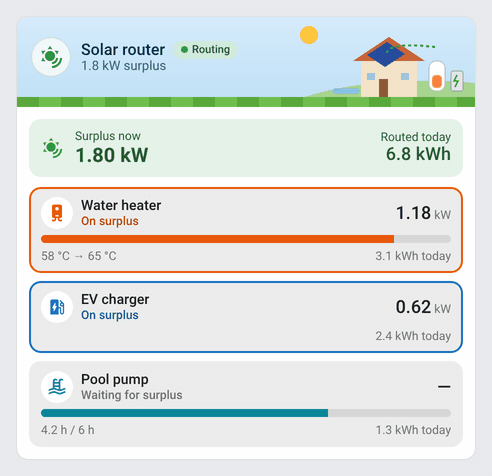 | 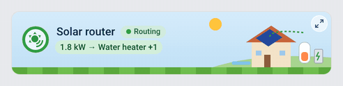 |

## Features

- **The surplus now and the energy routed today**, on a band that is green while there is surplus to route
- **One tile per device**: its icon and name, *On surplus*, *From the grid* or *Waiting for surplus*, its power while it runs, its progress (a water heater's temperature toward its target, a pool's filtration time…) and its energy of the day; the devices on the surplus are outlined in their colour
- **Water heaters, EV chargers, pool pumps, heaters, anything else**: each kind has its icon and colour, from the entity's domain and name (or `kind`)
- **The surplus from a sensor or from the grid meter**: a surplus sensor (a PV router's, a surplus manager's), else what the grid meter exports plus what the devices route
- **Status**: *Routing* while a device is on the surplus, *Surplus available* above the threshold, *Waiting for surplus* under it, *Night* once the sun has set
- **Illustrated header**: the house and its panels, a water heater whose hot water rises with its progress, an EV charger and a pool; the surplus runs from the panels to the devices while they route; the moon by night, the dark theme darkens the picture
- **Mini card**: the share of the surplus being routed as a ring around the badge, the state, the surplus and the devices on it; its zoom button opens the full card in place
- **Tap a tile** to open its entity's details
- Visual editor for both cards (the device list in YAML), light and dark themes, 22 languages, no external dependency

## Supported integrations

The card reads the grid and production meters, the routers and the surplus managers below; the devices are any `water_heater`, `switch`, `number` or charger entity:

| | Integration | What the cards show |
|:---:|---|---|
|  | [Shelly](https://www.home-assistant.io/integrations/shelly/) (built in) | Shelly EM / Pro 3EM grid and production meters |
|  | [ESPHome](https://www.home-assistant.io/integrations/esphome/) (built in) | Meters and DIY routers, including [Solar Router for ESPHome](https://github.com/XavierBerger/Solar-Router-for-ESPHome) |
|  | [MQTT](https://www.home-assistant.io/integrations/mqtt/) (built in) | MK2PVRouter, MSunPV and F1ATB routers |
|  | [Solar Optimizer](https://github.com/jmcollin78/solar_optimizer) (Marketplace) | Managed devices, their state and power |
|  | [PV Excess Control](https://github.com/InventoCasa/PV-Excess-Control) (Marketplace) | Appliances switched on the solar excess |

## Installation

### Via the Marketplace (recommended)

Click the button below to add the repository directly:

[](https://my.home-assistant.io/redirect/marketplace_repository/?owner=juju35&repository=ha-solar-router-card&category=plugin)

Or manually:

1. Open **Settings → Marketplace → Add from link** (top right; this needs a GitHub account connected)
2. Add `https://github.com/juju35/ha-solar-router-card` — Type: **Dashboard**
3. Open **Solar Router Card** and click **Install**
4. Clear your browser cache and refresh

The Marketplace registers the dashboard resource for you.

### Manual

1. Download `ha-solar-router-card.js` and the `ha-solar-router-card.i18n.*.js` translation files from the [latest release](https://github.com/juju35/ha-solar-router-card/releases/latest)
2. Copy them all to `/config/www/` (without the translation files, the cards show in English)
3. Go to **Settings → Dashboards → Resources** → Add resource:
   - URL: `/local/ha-solar-router-card.js`
   - Type: **JavaScript Module**
4. Clear your browser cache and refresh

## Configuration

The device list is set in YAML; every other option is in the visual editor.

```yaml
type: custom:solar-router-card
surplus: sensor.solar_surplus
devices:
  - water_heater.cumulus
  - entity: switch.ev_charger
    name: EV charger
  - entity: switch.pool_pump
    progress: sensor.pool_filtration_today
    target: 6

# The surplus worked out from the grid meter (negative while exporting)
type: custom:solar-router-card
grid: sensor.grid_power
routed: sensor.router_energy_today
devices:
  - entity: switch.cumulus_relay
    kind: water_heater
    power: sensor.cumulus_power
    energy: sensor.cumulus_energy_today

# Two lines on a phone dashboard, the devices of Solar Optimizer found by themselves
type: custom:solar-router-mini-card
surplus: sensor.solar_surplus
```

| Option | Type | Default | Description |
|---|---|---|---|
| `surplus` | string | a power sensor named *surplus* / *excess* | Both: the power available for routing (W) |
| `grid` | string | | Both: the grid meter's power (W), negative while exporting, when there is no `surplus`: the surplus is what the devices run on, less what is drawn from the grid |
| `grid_invert` | boolean | `false` | Both: the grid power is positive while exporting |
| `routed` | string | the devices' energies added up | Both: today's routed energy (kWh) |
| `threshold` | number | `100` | Both: below this surplus (W), there is nothing to route |
| `devices` | list | the switches of Solar Optimizer and PV Excess Control | YAML only: one item per device, an entity id or `entity`, `name`, `icon`, `kind` (`water_heater`, `ev`, `pool`, `heater`, `other`), `power` and `energy` (else the power and daily energy sensors of its device), `progress` (a sensor) and `target` (a number or a sensor), `unit` |
| `title` | string | `Solar router` | Card title |
| `show_title` | boolean | `true` | Both: show the title |
| `show_subtitle` | boolean | `true` | Both: the surplus (or the energy routed today) under the title |
| `navigation_path` | string | | Both: a tap on the header opens this dashboard path |
| `illustration` | boolean | `true` | Both: the illustrated header (`false`: the classic header) |
| `illustration_theme` | string | `auto` | Both: `auto` (follows the Home Assistant theme: night with a dark theme, day with a light theme), `day` or `night` |
| `animations` | boolean | `true` | Both: the surplus running to the devices |
| `zoom` | boolean | `true` | Mini card: the zoom button |
| `language` | string | Home Assistant's | Advanced: one of the [languages](#translations) |

## Screenshots

| Routing | Surplus available | Waiting for surplus |
|---|---|---|
|  | 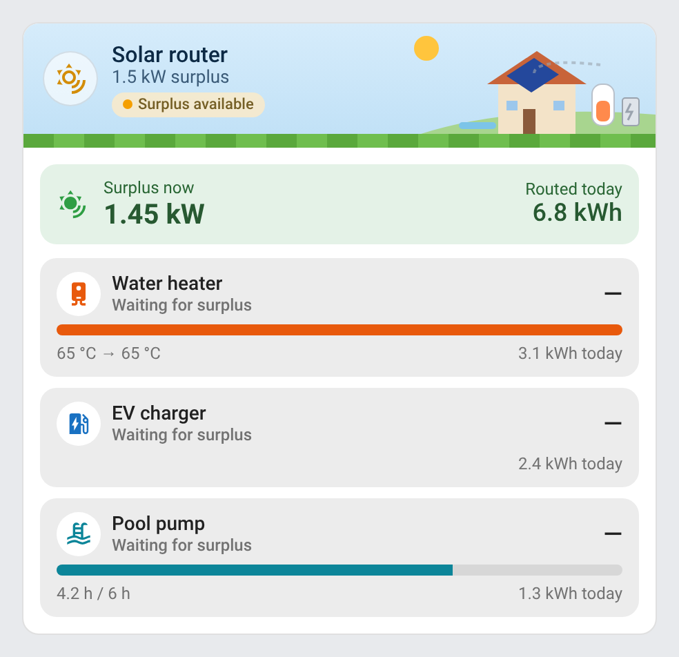 | 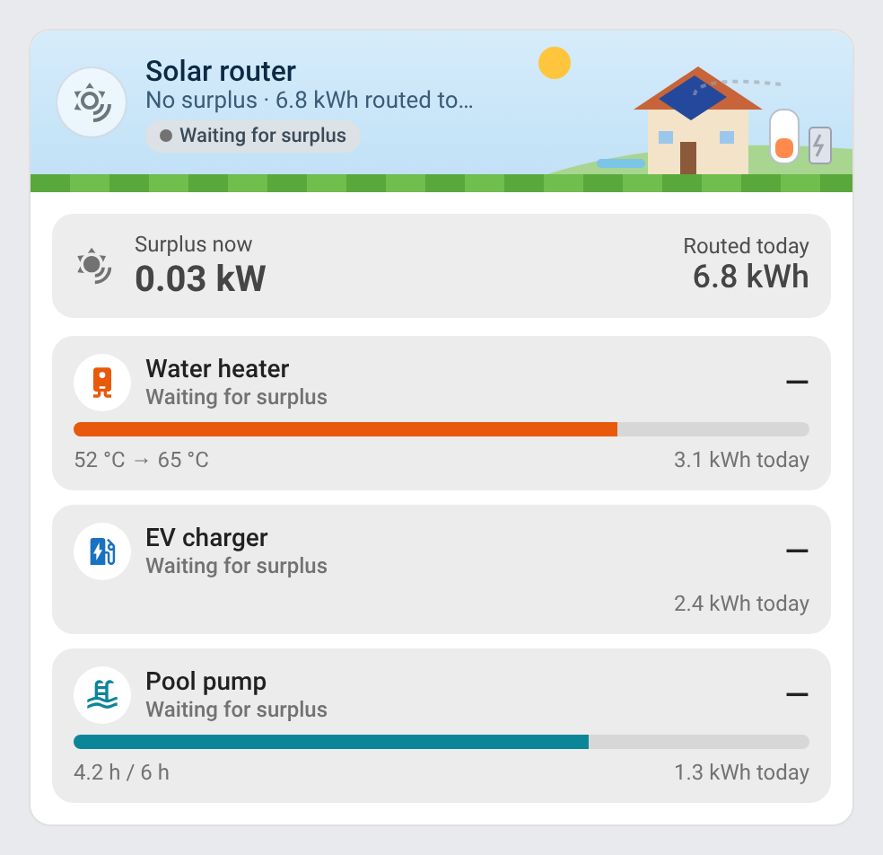 |
| 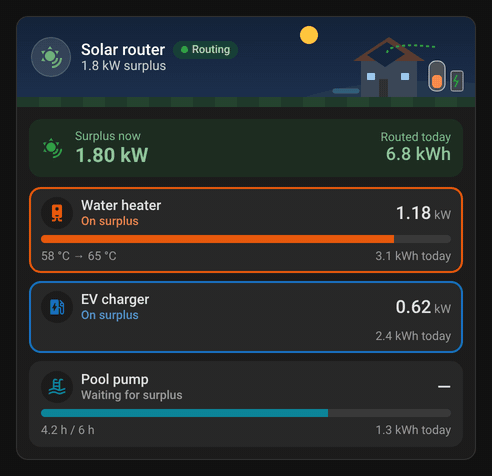 | 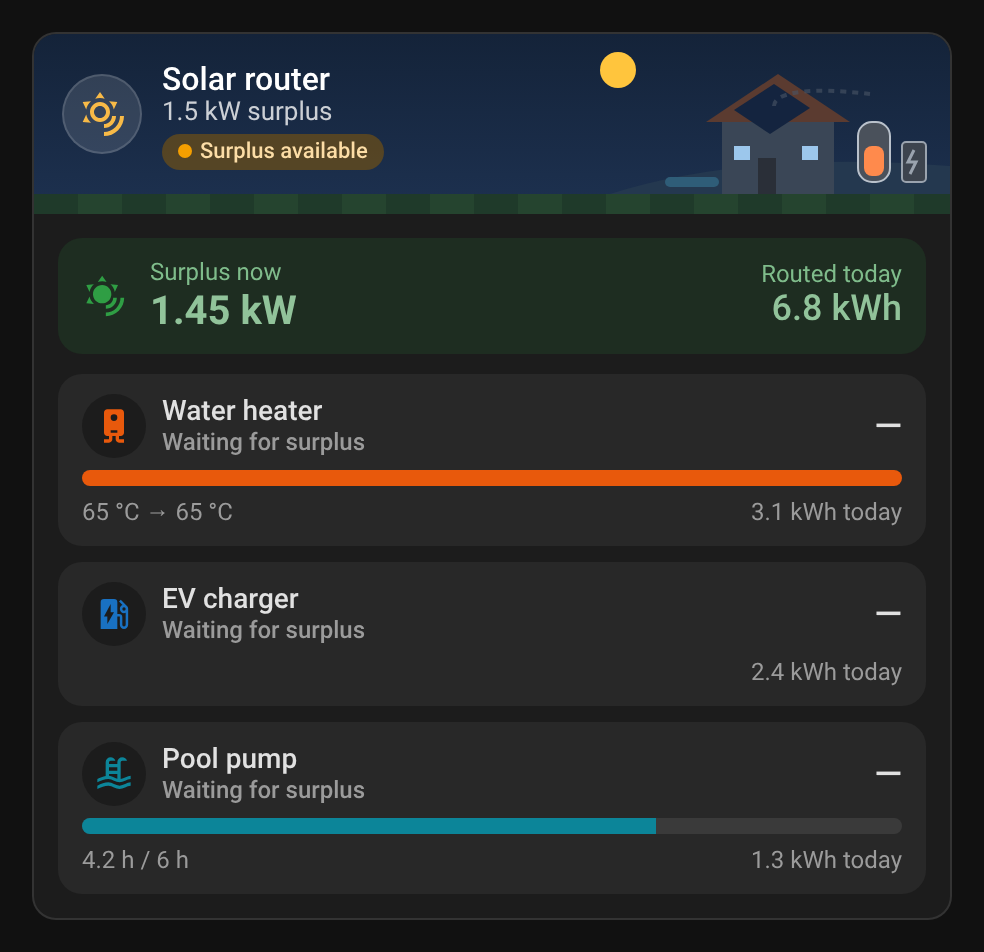 | 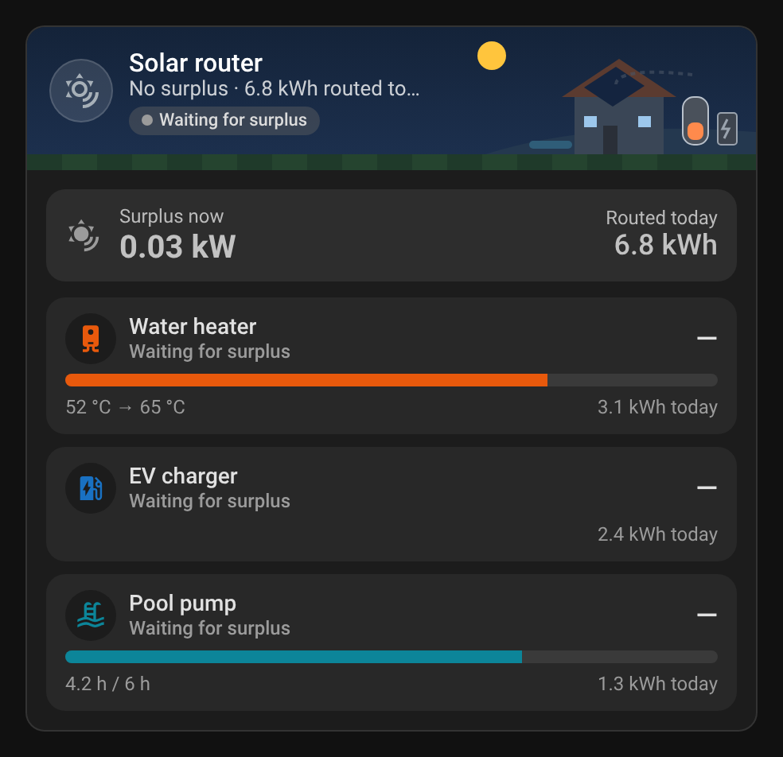 |

| Night | Narrow |
|---|---|
| 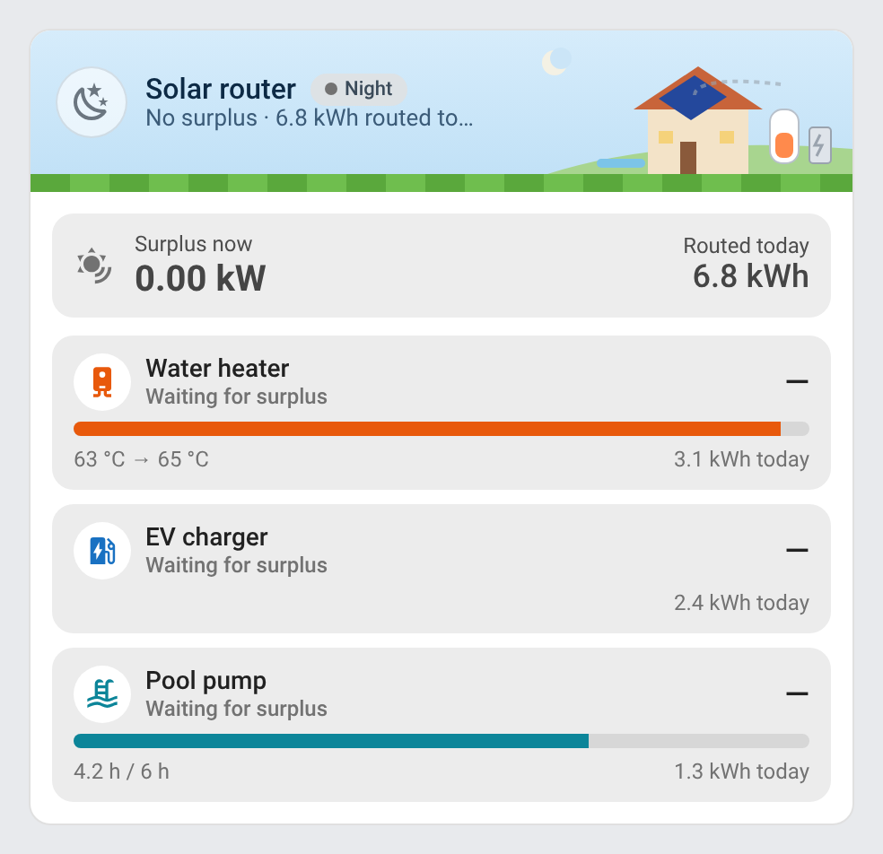 | 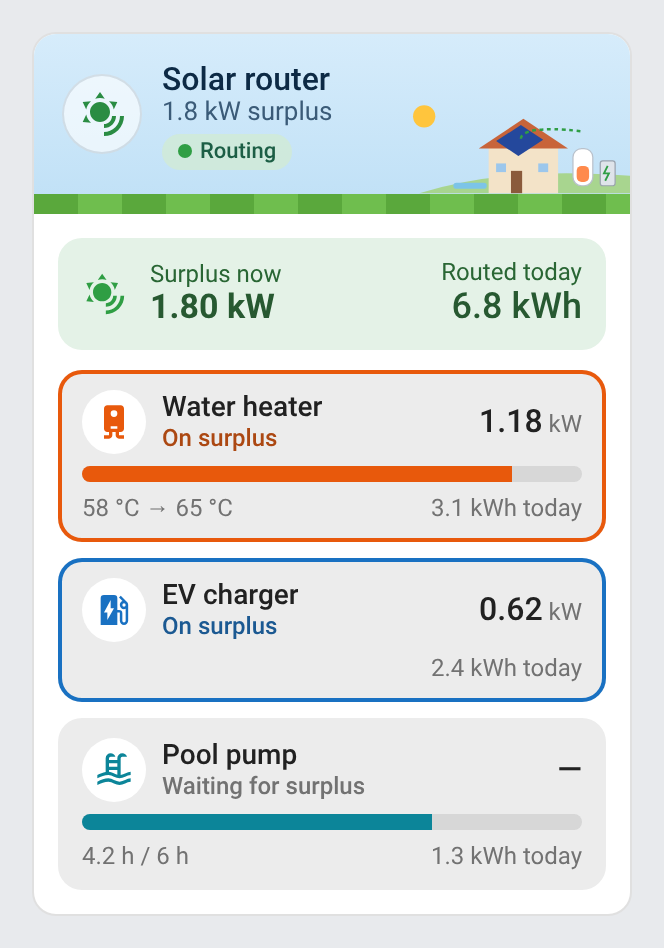 |
| 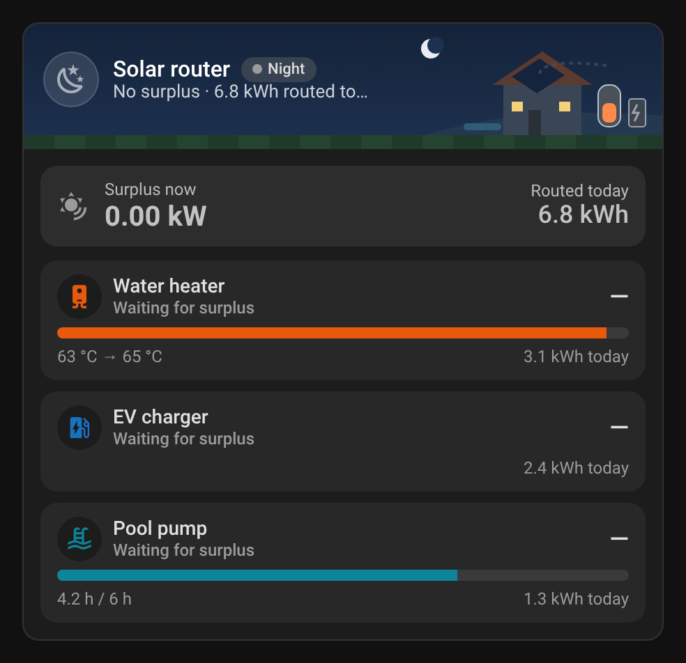 | 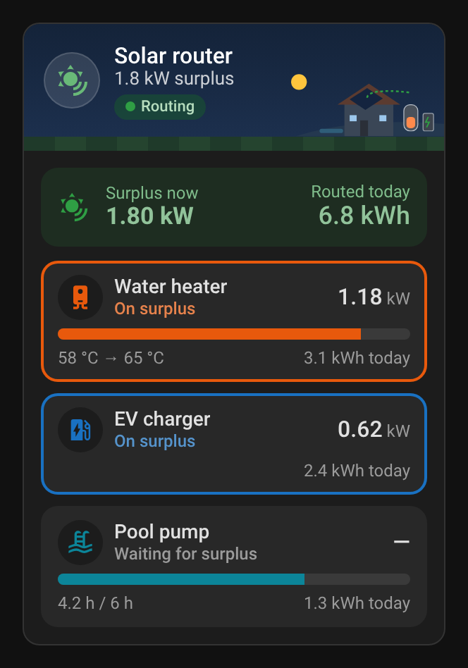 |

**Routing** is animated: the surplus runs as a dashed line from the panels to the devices while they route (still with `animations: false`, or when the system asks for reduced motion).

### Solar router mini

| Routing | Night | Zoomed in |
|---|---|---|
|  | 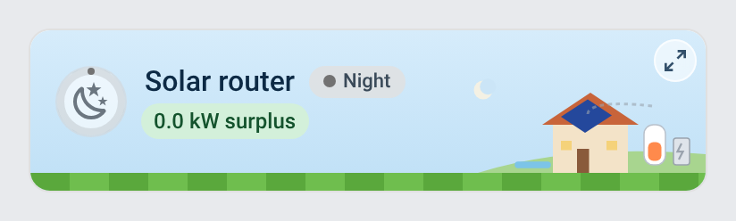 | 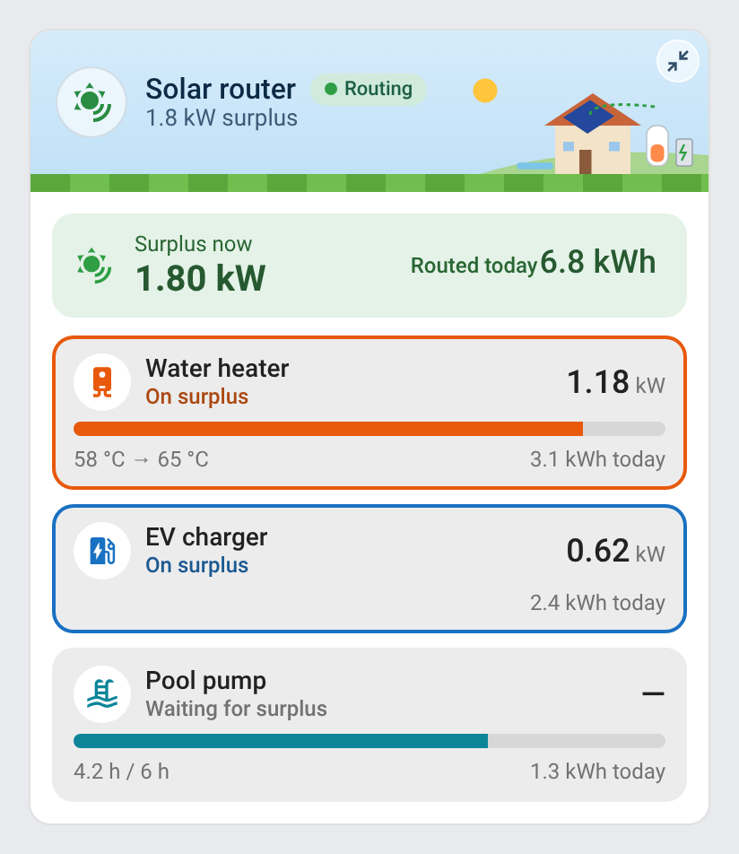 |
| 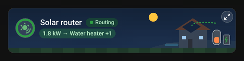 | 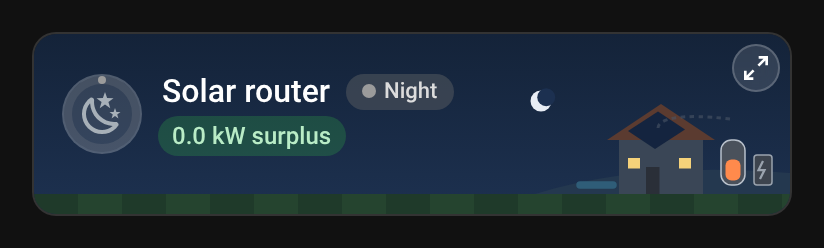 | 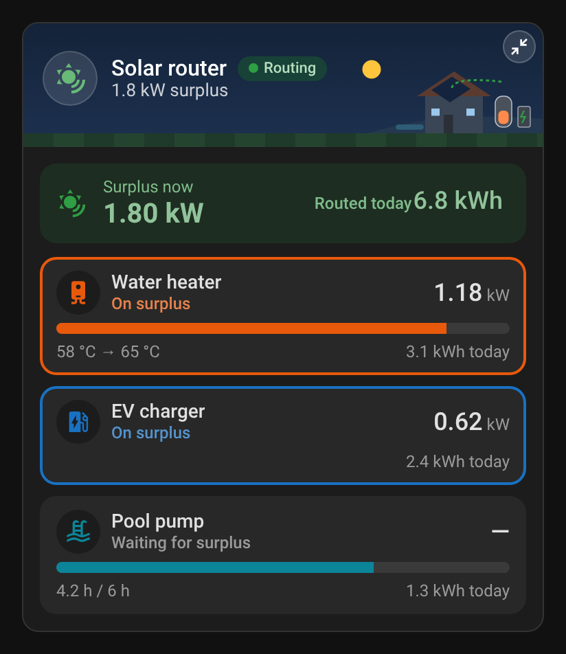 |

## How it works

- **Surplus**: `surplus`, else `grid` (the power of the running devices, plus what is still exported or less what is drawn from the grid), else the first power sensor named like a surplus (*surplus*, *excess*, *excédent*, *Überschuss*)
- **Devices**: `devices`, else the switches of Solar Optimizer and PV Excess Control; each device's power and energy of the day are its `power` and `energy`, else the first power sensor and the first daily energy sensor of its registry device
- **On surplus**: a running device (drawing more than 30 W, or, without a power sensor, `on`, heating or charging) while the sun is up and there is surplus; otherwise a running device is *From the grid* (an EV charging at night) and is not routed
- **Progress**: `progress` toward `target` (from 0, or from 15 ° for a temperature), else a water heater's temperature toward its target
- **Routed today**: `routed`, else the devices' energies of the day added up (they include what a device drew from the grid: set `routed` for the exact figure)
- **Read only**: the card calls no action; a tap opens the entity's details

## Development

```bash
npm install
npm run build        # stamps the version of package.json into dist/ha-solar-router-card.js
npm run check        # builds and checks the bundle (run in CI)
npm test             # unit tests
npm run screenshots  # renders the cards with a mock router into screenshots/ (and the GIFs, needs ffmpeg)
```

`dist/` is not committed: `npm run build` creates it locally, CI builds it on every push, and the release workflow attaches the built files to the release, which is where the Marketplace installs them from.

### Releasing

1. Bump `version` in `package.json`
2. Add a `## <version>` section at the top of [CHANGELOG.md](https://github.com/juju35/ha-solar-router-card/blob/main/CHANGELOG.md)
3. Push to `main`: the **Release** workflow builds the card, creates the tag and the GitHub release with the changelog section as notes, and attaches `ha-solar-router-card.js` and its translation files

## Translations

The card auto-detects the language from your Home Assistant settings. Currently supported:

| Language | Code |
|---|---|
| English | `en` |
| Français | `fr` |
| Deutsch | `de` |
| Español | `es` |
| Српски | `sr` |
| Srpski (latinica) | `sr-Latn` |
| Italiano | `it` |
| Nederlands | `nl` |
| Português (Portugal) | `pt` |
| Polski | `pl` |
| Română | `ro` |
| Dansk | `da` |
| Svenska | `sv` |
| Български | `bg` |
| Русский | `ru` |
| Українська | `uk` |
| Magyar | `hu` |
| Slovenčina | `sk` |
| Čeština | `cs` |
| Slovenščina | `sl` |
| Latviešu | `lv` |
| Ελληνικά | `el` |

Contributions for additional languages are welcome!

## License

[MIT](https://github.com/juju35/ha-solar-router-card/blob/main/LICENSE)

## Support

If you find this project useful, you can support its development:

<a href="https://buymeacoffee.com/julienstep9"></a>
